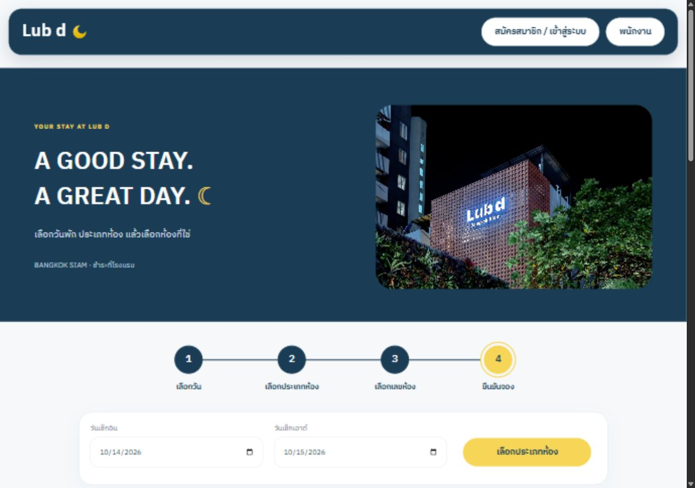
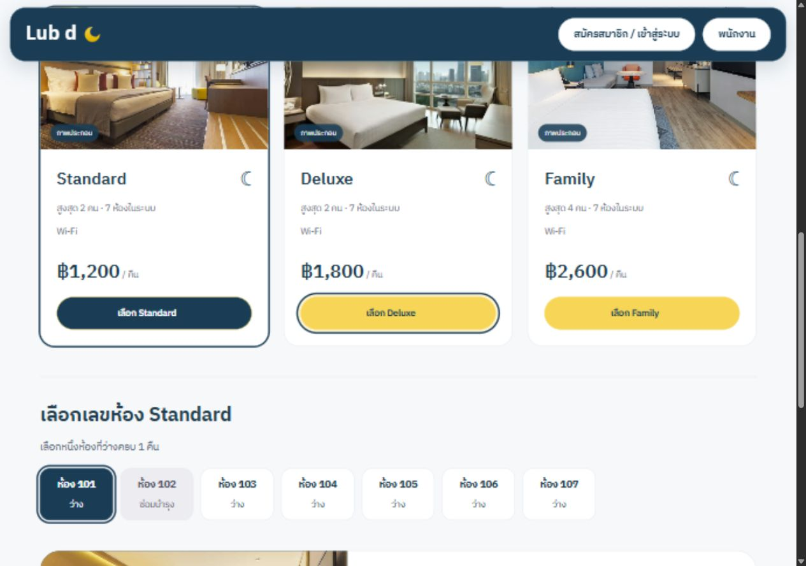
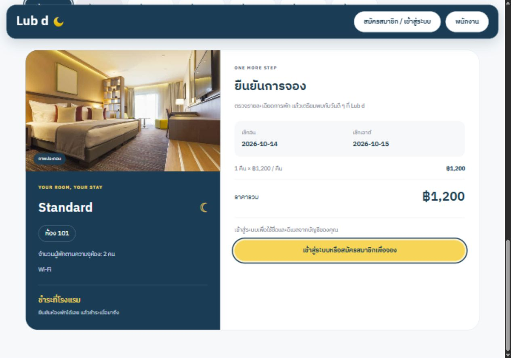
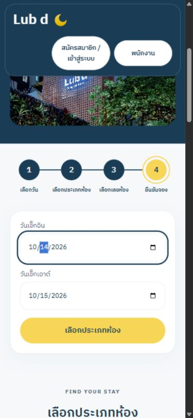
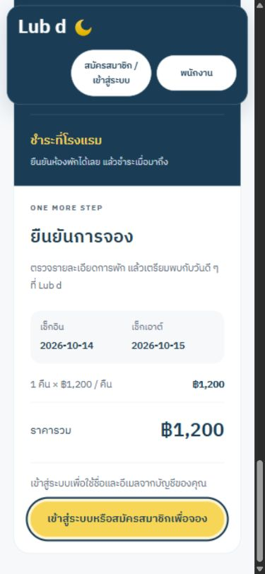

# Discover design verification — 14 October 2026

Updated `/discover` to follow Home's navy/yellow palette, heading sizes, rounded cards and spacing.

- Centered four-step timeline with connecting lines and current/completed states.
- Three room-type cards in one flex row on desktop; full-width cards on mobile.
- Confirmation card includes a room photo and amenities, room number/capacity, dates, price breakdown, total, pay-at-hotel note, account identity and contact fields.
- Eight existing customer/availability tests passed, including real signup/login, booking/history/staff visibility, duplicate submits, price reconfirmation and form preservation.
- Frontend build and lint passed. Browser checked at 1280×900 and 390×844; all four timeline circles align at the same height, desktop cards share the same row, and mobile page width is within the viewport. Keyboard Enter/Space selection remains functional.
- All browser inventory is synthetic in a disposable database; no deployment or live data was changed.

