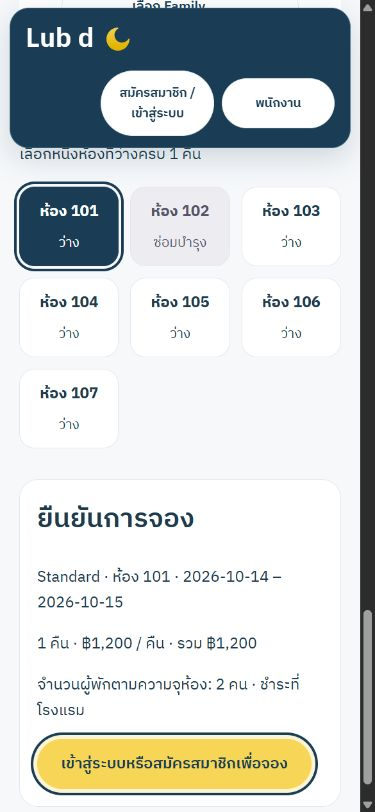
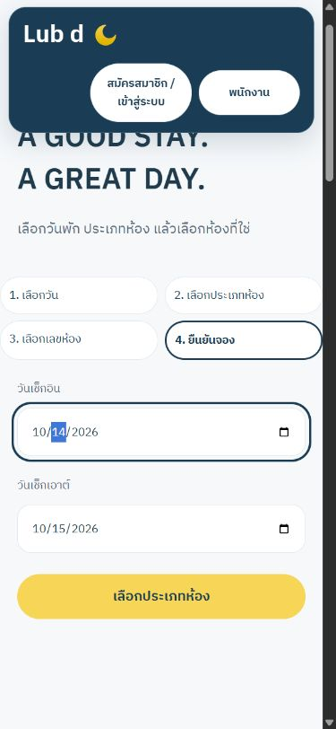
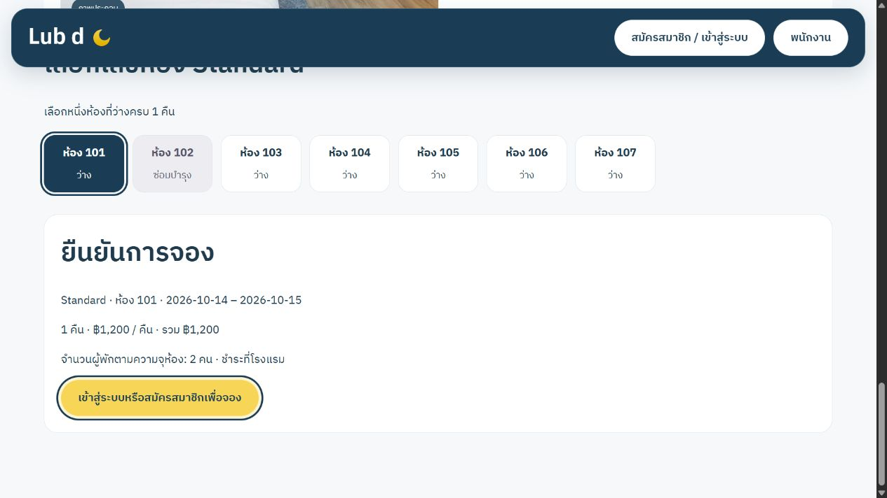

# Booking QA — 14 October 2026

## Scope and evidence

Local source changes only. No live deployment, schema push, backup, or staging/production data modification was performed.

- Backend booking flow and index preparation: 15 tests passed on isolated MongoDB replica sets.
- Existing staff/backend regression runner: all groups passed (`test:all:isolated`). The updated runner also includes the new customer/index suites in future CI runs.
- Frontend full suite: 51 tests passed. After the final login/protocol refinements, all 16 relevant API and customer-flow tests passed again, including both signup and existing-account login with selection restoration and staff visibility.
- `client`: TypeScript/Vite build and ESLint passed.
- `server`: JavaScript syntax lint and Prisma schema validation passed.
- Additive index preparation: preview makes no changes; apply preserves every field of legacy documents in an exact before/after comparison, is repeatable, and stops when room-night uniqueness is missing.

## Browser verification

Anonymous `/discover` against a disposable synthetic database. Keyboard Enter selected Standard, then Space selected room 101. Exactly one room was pressed, room 102 was disabled with the text “ซ่อมบำรุง,” and inactive room 108 was absent. The summary showed database capacity, nightly price, total and “ชำระที่โรงแรม.”

At a 390×844 viewport the document width was 375px (within the viewport including its scrollbar). The date form stacked vertically; all room buttons remained readable and the booking summary fit the screen. Keyboard focus outlines were visible. Viewport overrides were reset after testing.

The screenshots use fixture prices and rooms; deployed inventory and end-user bookings were not inspected or changed. Actual signup/confirmation/history and server-side ownership/race behavior were verified separately through React DOM + the real API on another isolated database.

